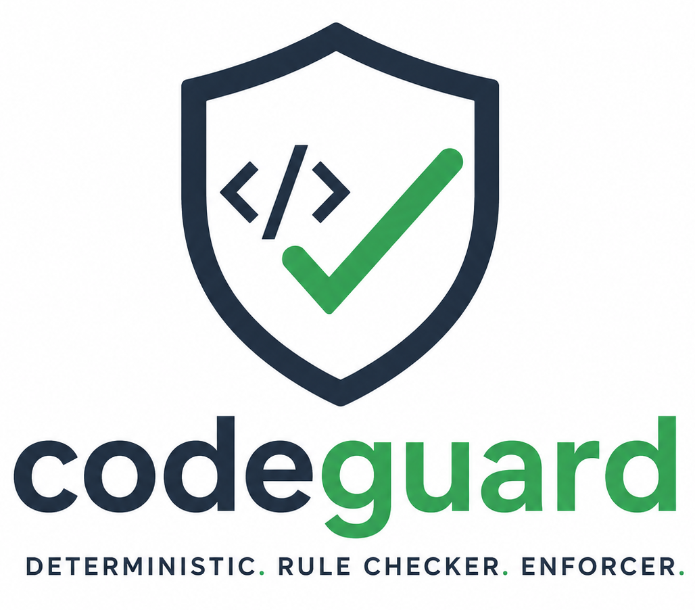

<p align="center">
  
</p>

<h1 align="center">CodeGuard</h1>
<p align="center"><em>Deterministic, machine-checkable engineering rules for .NET repositories.</em></p>

<p align="center">
  <a href="https://github.com/james-d12/CodeGuard/actions/workflows/ci.yml"></a>
  <a href="https://www.nuget.org/packages/CodeGuard"></a>
  <a href="LICENSE"></a>
</p>

CodeGuard checks a .NET repository against your organisation's engineering standards (DDD,
architecture layering, C# conventions, and so on) and reports structured violations. Rules are
declarative YAML, so new standards do not require changes to the engine.

CodeGuard complements static analysis and security tools such as SonarQube, Wiz and SOOS. It
enforces company-specific policy that those tools do not cover. It also works as a guardrail for
AI coding agents: agents load the applicable rules before generating code, and CodeGuard validates
the result.

## Install

```bash
dotnet tool install -g CodeGuard
```

`validate` requires a .NET SDK on the machine. See [Requirements](docs/USAGE.md#requirements) and
[Installation](docs/USAGE.md#installation) for standalone binaries and install scripts.

## Quickstart

Point CodeGuard at a rules source once. Every command then uses it, in any repository:

```bash
codeguard setup --source https://github.com/org/rules-repo.git --branch main
```

Then:

```bash
codeguard info                                  # active rules source and rule count
codeguard rules list                            # rules discovered from the source
codeguard rules explain DDD-ENTITY-001          # full metadata and YAML for one rule
codeguard validate --format json --output report.json
```

Use `--rules-source <dir-or-git-url>` on any command to override the configured source for that
run only. See [Configuring rule sources](docs/USAGE.md#configuring-rule-sources).

## Example rule

A rule has a `target` selector that picks code elements, and one or more `assertions` that every
match must satisfy. This sample is from [`examples/rules/ddd/ddd-entity-001.yml`](examples/rules/ddd/ddd-entity-001.yml):

```yaml
id: DDD-ENTITY-001
name: Domain entities must inherit from Entity
description: >
  All domain entities must inherit from the approved Entity<TId> base class.
severity: error
enforcement:
  classification: deterministic
tags:
  - ddd
  - domain
  - entity
remediation: >
  Inherit from Contoso.Domain.Entity<TId>.

target:
  kind: class
  namespace: "Contoso.Domain.Entities"

assertions:
  - must_inherit_from:
      type: "Contoso.Domain.Entity<*>"
```

A failing assertion is reported as a violation at the rule's `severity`, with its `remediation`
text attached.

## Author and test a rule

```bash
codeguard rules validate    # structural check of rule YAML against the JSON Schema
codeguard rules test        # run each rule's embedded tests: cases, no repository needed
codeguard rules analyze     # rule-set problems: missing tests, unreachable assertions, duplicates
codeguard rules discover    # every selector, assertion and analyzer kind the engine supports
```

Embedded test format is described in [`docs/done/RULES_TEST_DESIGN.md`](docs/done/RULES_TEST_DESIGN.md).

## Documentation

- [Detailed usage](docs/USAGE.md): requirements, installation, full CLI reference, rule sources,
  rule anatomy, configuration and project layout
- [Documentation index](docs/README.md): every doc under `docs/`, grouped by status
- [`CLAUDE.md`](CLAUDE.md): contributor and agent guidance, architecture and gotchas
- [`docs/PRIMITIVES.md`](docs/PRIMITIVES.md): original design rationale

## Contributing

```bash
dotnet build
dotnet test
```

Build and test requirements, and the architecture notes contributors need, are in
[`CLAUDE.md`](CLAUDE.md).
